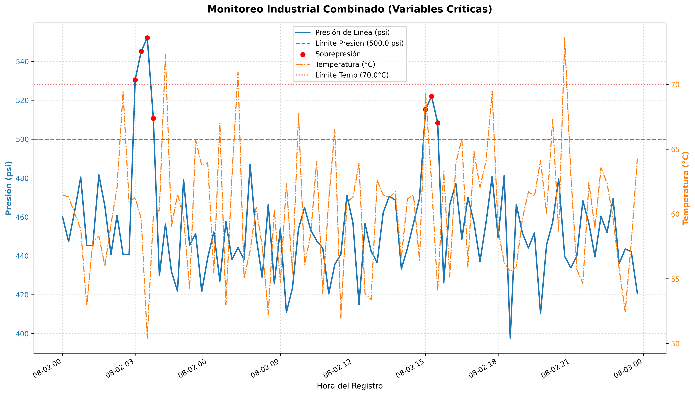

# Sistema de Monitoreo Automatizado de Variables Críticas (Oil & Gas)

Este proyecto desarrolla un script automatizado en **Python** utilizando las librerías **Pandas**, **NumPy** y **Matplotlib** para simular, analizar y reportar el comportamiento de variables críticas de proceso (Presión y Temperatura) en una planta de operaciones industriales.

## 🛠️ Problema Industrial que Resuelve
En plantas de procesos continuos, la revisión manual de registros históricos de sensores genera demoras en la detección de fallas. Este sistema automatiza la auditoría diaria filtrando desvíos operativos en segundos, previniendo daños mecánicos por sobrepresión o desvíos térmicos.

## 🚀 Características Técnicas
- **Ingesta y Simulación de Datos:** Generación de DataFrames con registros temporales continuos de sensores industriales.
- **Lógica de Procesos:** Filtros avanzados con operadores lógicos para identificar picos de presión (> 500 psi) y alta temperatura (> 70 °C).
- **Reporte Automatizado:** Uso de lógica condicional para asignar diagnósticos técnicos automatizados exportables a CVS.
- **Visualización Profesional:** Generación automática de gráficos de control con **doble eje Y** independientes para correlacionar variables y marcas visuales de alerta.

## 📊 Visualización del Panel de Control
Aquí se puede observar la gráfica combinada generada automáticamente por el script:

## 🧰 Tecnologías Utilizadas
- **Python 3**
- **Pandas** (Estructuración y análisis de datos de planta)
- **NumPy** (Lógica condicional analítica)
- **Matplotlib** (Diseño de interfaz gráfica industrial)
